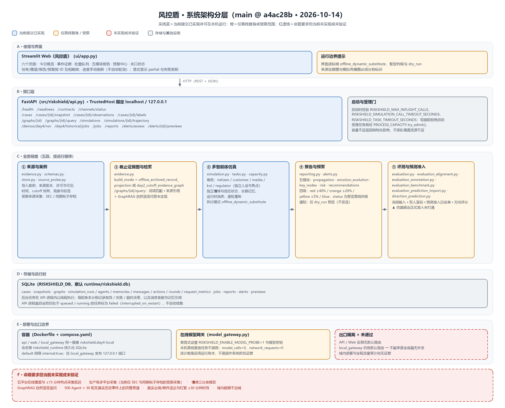
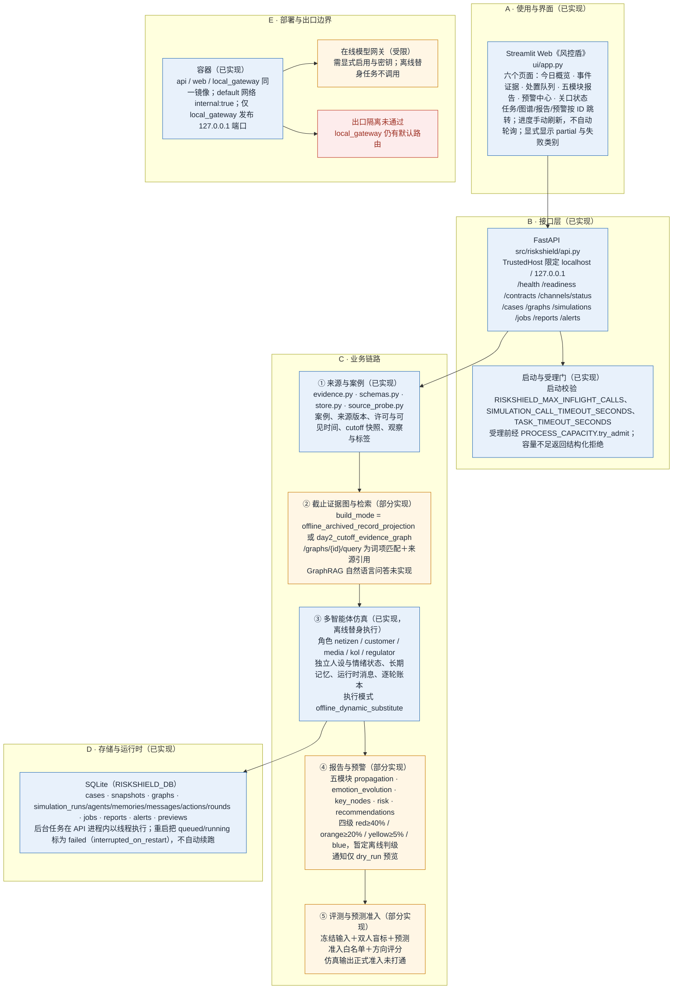
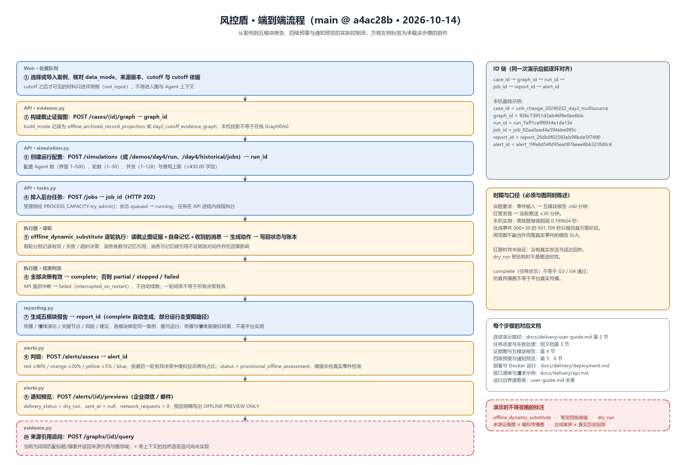
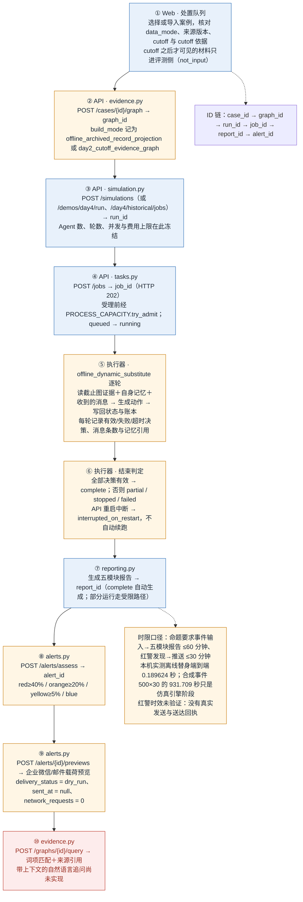
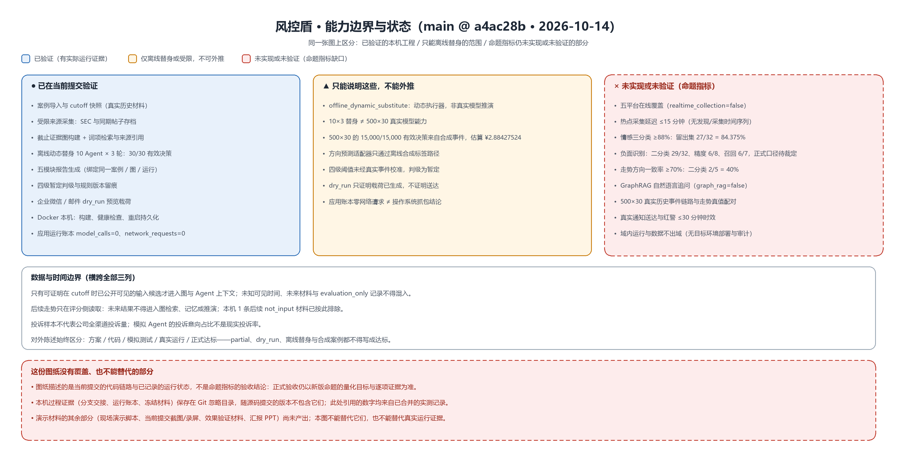
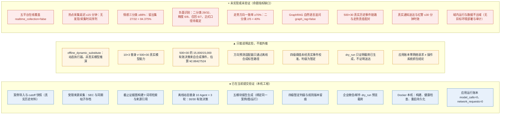

# 技术架构与流程图

> 2026-10-14 基线，绑定提交 `main @ a4ac28b`。本文是演示材料中"技术架构图 / 流程图"一项的交付件，含三张图：系统架构分层、端到端流程、能力边界与状态。
>
> 图标题中的 `a4ac28b` 是**被描述的代码基线**；本文、图上产物与生成脚本一起提交在 `main` 上，实际提交号可用 `git log -1 -- docs/design/技术架构与流程图-2026-10-14.md` 查到。
>
> 图上的每一处标注都取自当前提交的代码与已合并的实测记录：接口清单来自 [api.py](../../src/riskshield/api.py)，四级阈值与五模块名称来自 [alerts.py](../../src/riskshield/alerts.py) 与 [reporting.py](../../src/riskshield/reporting.py)，"未实现 / 未验证"一列来自 `/readiness` 的 `capabilities`、`blockers` 与[测试与运行报告](../delivery/test-report.md)。**未实现或未验证的能力按图例画成红色虚线，不因为图纸好看而写成达标。**

## 一、图纸清单

| 图 | 用途 | 矢量版 | 位图版 |
| --- | --- | --- | --- |
| 图 1 系统架构分层 | 说明平台由哪些层组成、各层当前实现到什么程度 | [architecture-overview-v1.svg](assets/architecture-overview-v1.svg) | [architecture-overview-v1.png](assets/architecture-overview-v1.png) |
| 图 2 端到端流程 | 说明一次运行从案例到报告、预警、通知预览的实际控制流与 ID 链 | [end-to-end-flow-v1.svg](assets/end-to-end-flow-v1.svg) | [end-to-end-flow-v1.png](assets/end-to-end-flow-v1.png) |
| 图 3 能力边界与状态 | 说明哪些能力已验证、哪些只能离线替身、哪些仍是命题指标缺口 | [boundary-status-v1.svg](assets/boundary-status-v1.svg) | [boundary-status-v1.png](assets/boundary-status-v1.png) |

用法：PNG 直接插入 PPT 与文档；需要放大或改配色时用 SVG；两份都由同一脚本生成，内容一致。

## 二、图 1 · 系统架构分层



### 可编辑文本版（Mermaid）



### 读图要点

1. **六层自下而上**：使用与界面 → 接口 → 业务链路 → 存储与运行时 → 部署与出口。业务链路按运行顺序固定为"来源与案例 → 证据图与检索 → 多智能体仿真 → 报告与预警 → 评测与预测准入"。
2. **仿真角色固定五类**：`netizen / customer / media / kol / regulator`，每类有独立人设、焦点、情绪与信任状态；每轮读取截止图证据、自身记忆与收到的消息后生成动作并写回。
3. **两种图必须分开讲**：`/graphs/{id}` 是**来源证据图**（表达来源与主张的证据关系），报告里的传播图是**模拟传播图**（运行时消息），前者不是社交平台传播。
4. **报告五模块有固定键名**：`propagation`、`emotion_evolution`、`key_nodes`、`risk`、`recommendations`，各模块绑定同一案例、图与运行。
5. **四级阈值是暂定值**：红 ≥40%、橙 ≥20%、黄 ≥5%、低于 5% 为蓝，判级状态为 `provisional_offline_assessment`，阈值未经真实事件校准。
6. **出口边界没有通过**：API / Web 实测无默认路由，但 `local_gateway` 仍有默认路由，因此不能承诺全容器无外发，"数据不出域"未验证。

## 三、图 2 · 端到端流程



### 可编辑文本版（Mermaid）



### 读图要点

1. **一次演示要能逐环对齐 ID**：`case_id → graph_id → run_id → job_id → report_id → alert_id`。本机基线示例见图上右侧面板与[测试与运行报告](../delivery/test-report.md)。
2. **进度不是自动的**：页面需手动点击"刷新任务进度"读取最新状态；`result_state` 区分成功、部分完成、停止与失败，只有全部决策有效的 `complete` 才自动生成报告与预警。
3. **两种时限不要混用**：命题的 ≤60 分钟是"事件输入到完整报告"，≤30 分钟是"红警发现到实际推送"；本机 0.189624 秒是离线替身链路耗时，931.709 秒是合成事件 500×30 的仿真引擎阶段耗时，都不等于真实事件的模型 SLA。
4. **`dry_run` 不是送达**：预览只证明载荷已生成并留档，收件人为空、`sent_at=null`、`network_requests=0`，不产生送达回执。
5. **`complete` 不等于关口通过**：任务状态完成不等于 G3 / G4 通过，也不等于命题指标达标。

## 四、图 3 · 能力边界与状态



### 可编辑文本版（Mermaid）



### 数据与时间边界（横跨三列）

- 只有可证明在 cutoff 时已公开可见的输入候选才进入图与 Agent 上下文；未知可见时间、未来材料与 `evaluation_only` 记录不得混入。
- 后续走势只在评分侧读取：未来结果不得进入图检索、记忆或推演；本机 1 条后续 `not_input` 材料已按此排除。
- 投诉样本不代表公司全渠道投诉量；模拟 Agent 的投诉意向占比不是现实投诉率。
- 对外陈述始终区分：方案 / 代码 / 模拟测试 / 真实运行 / 正式达标——`partial`、`dry_run`、离线替身与合成案例都不得写成达标。

## 五、用色判定依据

| 颜色 | 含义 | 判定来源 |
| --- | --- | --- |
| 蓝色实线 | 当前提交已实现并可在本机运行 | `/readiness` 的 `capabilities` 中为 `true`，或代码与部署文档可核对的链路 |
| 橙色实线 | 已实现但只在离线替身或受限范围内成立 | `offline_dynamic_substitute` 执行模式、受限采集、`dry_run`、暂定阈值 |
| 红色虚线 | 命题要求但未实现或未验证 | `/readiness` 的 `capabilities` 中为 `false`（`realtime_collection`、`graph_rag`、`sentiment_analysis`、`forecast` 等）、`blockers` 列表，或[测试与运行报告](../delivery/test-report.md)标为未验证的项目 |
| 灰色 | 存储、运行时与基础设施 | [部署与运行](../delivery/deployment.md)、[compose 配置](../../compose.yaml) |

## 六、复现与更新

```powershell
# 生成三张图的 SVG 与 PNG（默认写入 docs/design/assets/）
& '.\.venv\Scripts\python.exe' 'scripts\render_design_diagrams.py'

# 只重画一张
& '.\.venv\Scripts\python.exe' 'scripts\render_design_diagrams.py' --only architecture-overview-v1
```

生成脚本：[render_design_diagrams.py](../../scripts/render_design_diagrams.py)。脚本会在写出文件前自检三项，任何一项不合格即以非零退出码并打印 `WARNING`：

1. **宽度**：每个标题与正文字符串按实际字体测量，超出所在卡片或面板即报警；
2. **高度**：正文行高总和超出卡片高度即报警；
3. **字形**：文本中若含所选字体没有的字形（会渲染成空方框）即报警。

本次生成环境：Python 3.12.4、Pillow 12.3.0、字体 `C:\Windows\Fonts\msyh.ttc`（微软雅黑），PNG 按画布 2 倍栅格化。更新流程：改脚本内容 → 重跑脚本至无 `WARNING` → 目视核对 PNG → 提交易脚本与产物。

## 七、已知限制

1. **本机没有 Mermaid 渲染器**（无 mermaid-cli，site-packages 也无 cairosvg / matplotlib）。Mermaid 块是同一内容的可编辑文本版，便于评审与修改；**SVG / PNG 由上述脚本生成，两者若不一致以脚本输出为准**，Mermaid 语法未在本机渲染验证。
2. **图纸只描述当前提交**。提交、接口或阈值变化后需重跑脚本，旧图不得继续使用（旧截图与旧图纸同样不能证明当前版本）。
3. **图纸不覆盖演示材料的其余部分**：现场演示脚本、当前提交的操作截图或录屏、对外效果验证材料与汇报 PPT 均尚未产出。
4. **图纸不是验收结论**。正式验收以[新版命题](../sources/2026-09-30-新版命题-多智能体仿真舆情监测.md)的量化目标与逐项证据为准；本机过程证据（分支交接、运行账本、冻结材料）保存在 Git 忽略目录，随源码提交的版本不包含它们。
